# Binary Brew — App Flow

| | |
|---|---|
| Version | 0.1 (draft) |
| Date | 2026-10-08 |
| Related | [01 PRD](01-product-requirements.md) · [02 Tech](02-technical-requirements.md) · [04 Design Brief](04-design-brief.md) · [05 Schema](05-backend-schema.md) |

This document describes how people move through the app and how the system reacts. Screen IDs (C-xx customer, S-xx counter, T-xx board, O-xx owner) are defined in the [Design Brief](04-design-brief.md#3-screen-inventory) and used here and in the implementation plan.

---

## 1. Surfaces and routes

| Surface | Who | Device | Route | Screens |
|---|---|---|---|---|
| Customer app | Customer | Own phone, portrait | `/o/{qrToken}` (menu), `/o/{qrToken}/cart`, `/pay/{publicToken}`, `/s/{publicToken}`, `/r/{publicToken}` | C-01 to C-08 |
| Counter | Staff, Barista, Owner | Tablet, landscape | `/counter/login`, `/counter` | S-01 to S-09 |
| Kitchen display (Phase 3) | Barista | Tablet or monitor | `/counter/kitchen` | S-10 |
| Queue board | Everyone (passive) | TV or monitor | `/board` | T-01 |
| Owner area | Owner | Phone or laptop | `/owner/...` | O-01 to O-16 |

## 2. Order state machine

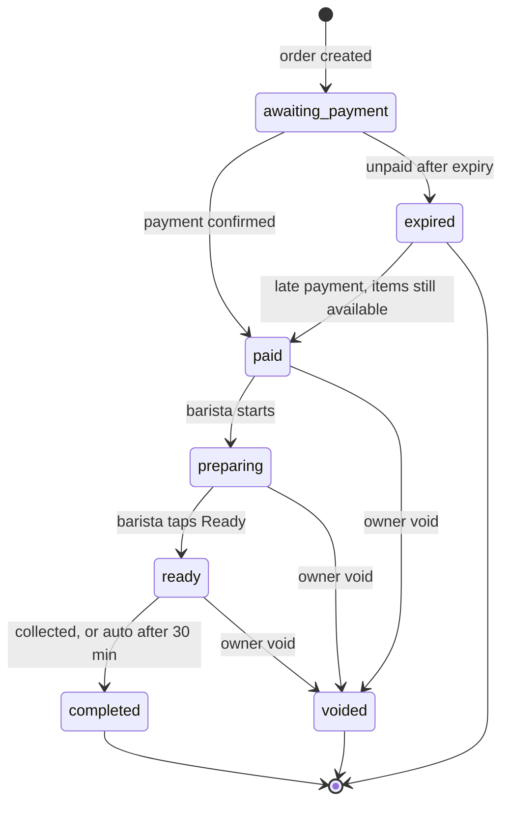

| Transition | Who/what triggers it | Side effects |
|---|---|---|
| created → `awaiting_payment` | Customer checkout or counter order | `payments` row `pending`, expiry timer set |
| → `paid` | Payment webhook, or manual confirmation | Queue number assigned; stock deducted (Phase 2); COGS snapshot; SSE event; counter chime |
| → `expired` | Worker sweep when `expires_at` has passed | Pending payment marked `expired`; charge cancelled at the provider (best effort) |
| `expired` → `paid` | Late webhook with items available | Same as paid; otherwise an automatic refund request is created |
| → `preparing` | Barista/Staff taps Start | `preparing_at`; SSE |
| → `ready` | Barista/Staff taps Ready | `ready_at`; customer phone sound and vibration; board moves the number to Ready |
| → `completed` | Staff taps Collected, or auto after 30 minutes | `completed_at`; number leaves the board |
| → `voided` | Owner or staff with owner PIN | Stock returned or logged as waste; refund request; audit |

No other transitions exist (BR-01).

## 3. Customer journey (self-order)

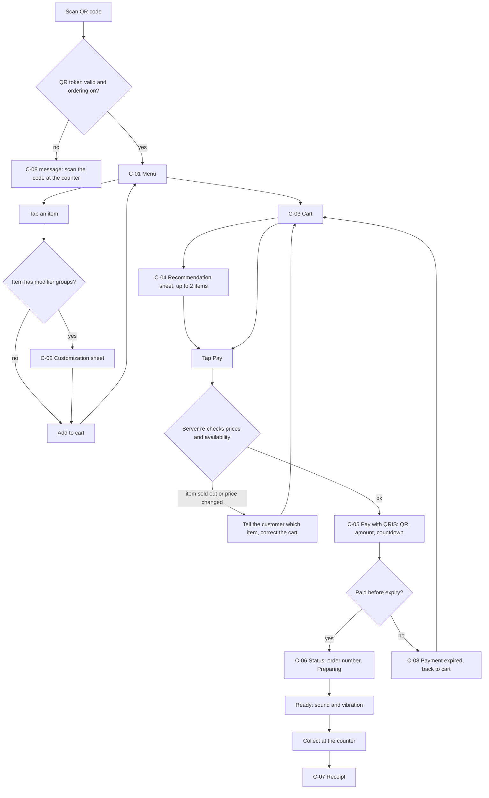

Notes:

- The cart lives in the browser (`sessionStorage`); nothing is saved on the server until checkout.
- The browser remembers the last few `publicToken`s in `localStorage` so a customer who closes the tab can reopen their order (the page shows a "Pesanan saya" list on C-01).
- Between pay and Ready the customer can only watch; there is no edit or cancel (BR-06).

## 4. Payment sequence

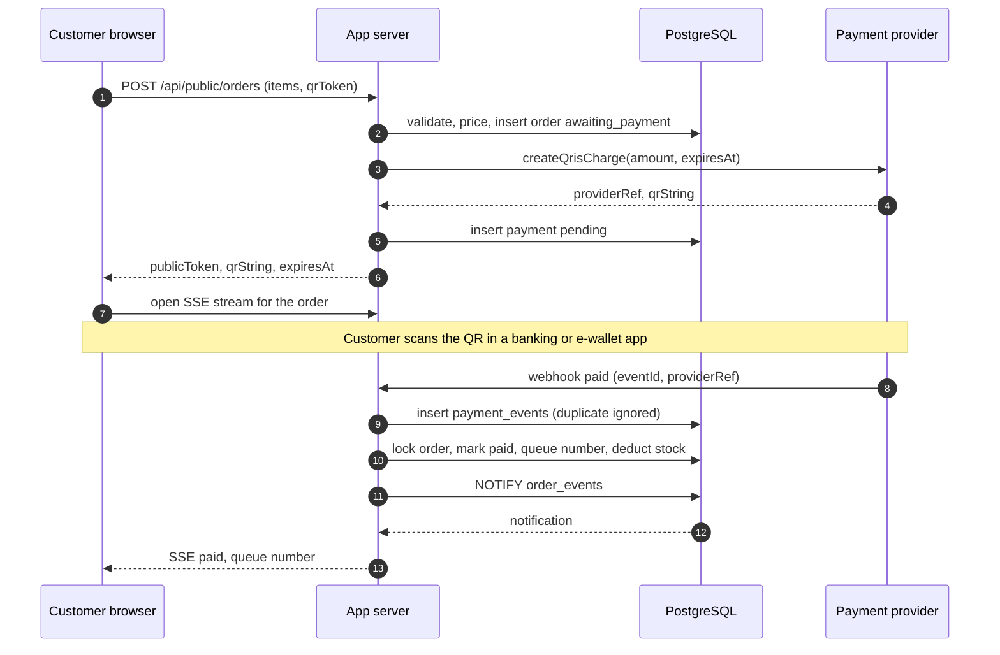

With the mock provider, step "PP → webhook" is triggered by a dev-only button on the payment page (`POST /api/dev/mock-pay/{paymentId}`) and goes through the same verification and processing code.

## 5. Counter flows

### 5.1 Start of shift

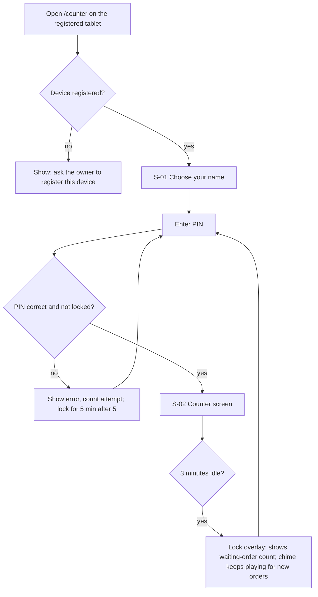

### 5.2 Handling the queue

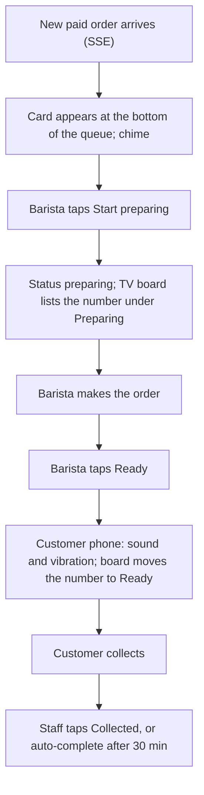

### 5.3 Walk-in order at the counter (POS)

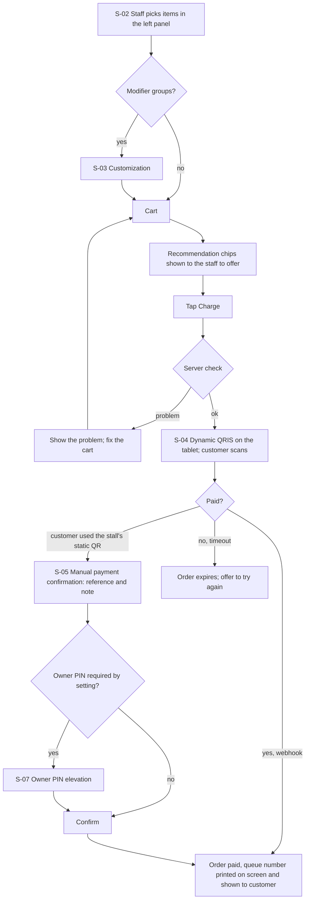

### 5.4 Manual payment confirmation

1. The static QR is a fixed code; the customer typed the amount themselves. The staff member opens the bank or e-wallet app and finds the matching payment.
2. In S-05 the staff member enters the payment reference (for example the last digits of the transaction id) and an optional note.
3. If `manual_payment_requires_owner_pin` is `true` (default), S-07 asks for the owner's PIN.
4. The server cancels the pending dynamic charge, records a `qris_static_manual` payment with the confirming user and reference, marks the order paid, and writes an audit entry.

## 6. Availability and sold-out logic

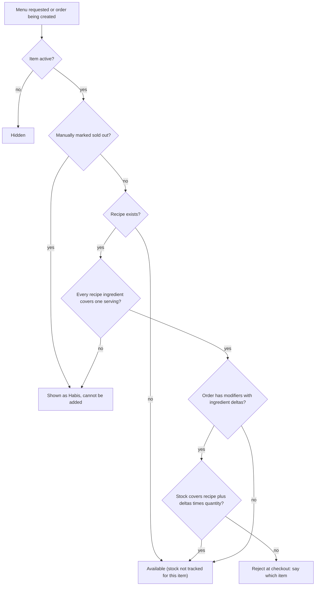

- Availability is shown on the menu (base serving) and enforced again at checkout (full order).
- If stock runs out after the customer received the QR but before they pay, the payment is accepted (the money is real) and stock goes negative (BR-05). The owner sees a negative-stock warning.
- The owner gets a **low-stock** warning at the ingredient's minimum level, before items start disappearing.

## 7. Recommendation flow

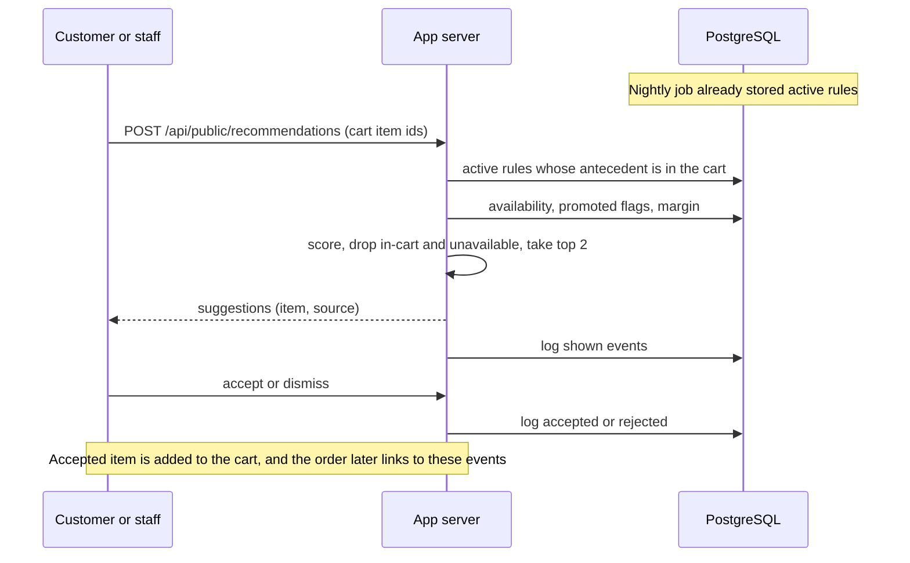

Fallback rules: no matching rule → show one promoted available item if any, otherwise show nothing. The app never blocks checkout waiting for recommendations; if the call fails or takes more than 1.5 seconds, the sheet is skipped.

## 8. Authentication and elevation

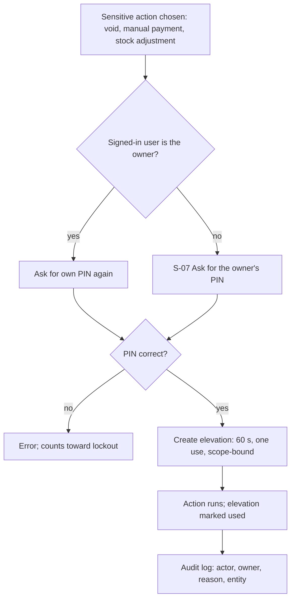

## 9. Void and refund (Phase 3)

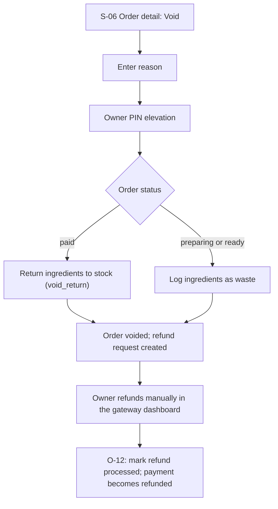

## 10. Inventory flows (Phase 2–3)

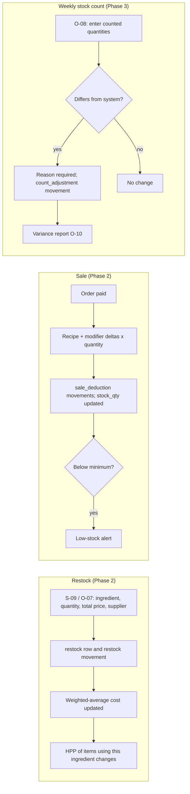

## 11. Nightly recommendation job

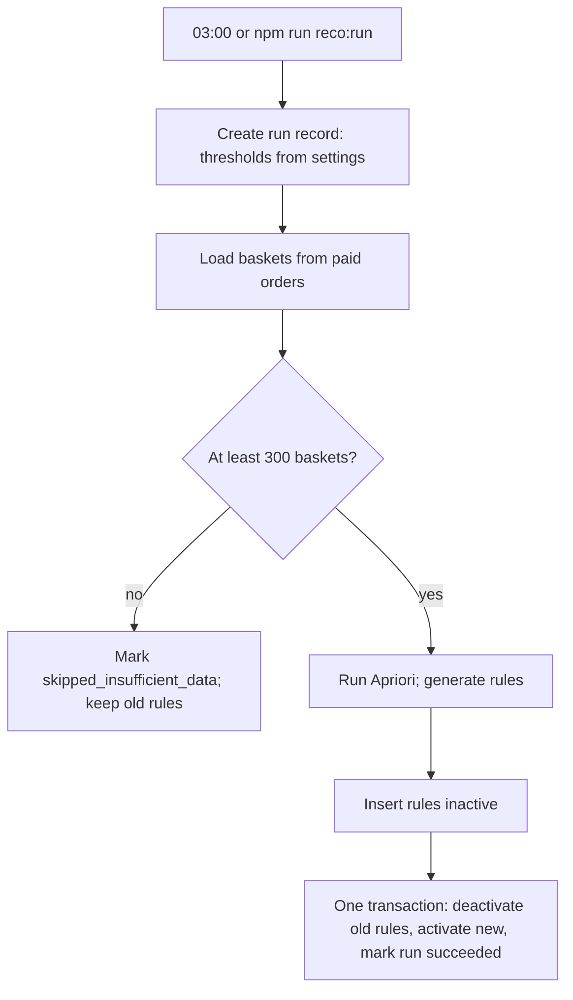

## 12. Real-time event map

| Event (NOTIFY `order_events`) | Emitted when | Listeners and effect |
|---|---|---|
| `order.paid` | Payment confirmed | Counter list adds card and chimes; customer status page shows queue number; board adds under Preparing only after `preparing` |
| `order.preparing` | Barista starts | Board lists number under Preparing; status page updates |
| `order.ready` | Barista taps Ready | Board moves number to Ready; status page plays sound and vibrates |
| `order.completed` | Collected or auto | Board removes number; counter card moves to history |
| `order.expired` | Sweep | Customer page shows expired state |
| `order.voided` | Owner void | Counter and status page update; board removes number |
| `stock.low` | Stock at or below minimum after a sale | Owner dashboard badge |

Clients fall back to polling every 10 seconds if the stream is down.

## 13. Edge cases and expected behaviour

| # | Situation | Behaviour |
|---|---|---|
| E1 | Customer double-taps Pay | Idempotency key returns the same order and charge. |
| E2 | Customer closes the tab after paying | Order continues normally; reopen from "Pesanan saya" (stored token) or watch the board for the number. |
| E3 | Customer pays after the countdown ended | Late payment rule: revive if items are available, otherwise automatic refund request; owner is alerted. |
| E4 | Customer pays twice for one order | Second payment has no matching pending charge → logged, refund request created, owner alerted. |
| E5 | Webhook is delivered twice or out of order | Idempotent by `(provider, event_id)`; state only moves forward. |
| E6 | Price changed between menu load and checkout | Server returns new prices; customer must confirm the new total before the QR is shown. |
| E7 | Item deactivated or sold out between cart and checkout | Checkout is rejected with the item names; cart is corrected. |
| E8 | Ingredient runs out after QR was shown | Payment is accepted; stock may go negative; owner warning. |
| E9 | Ordering switched off (`ordering_enabled = false`) | C-01 shows the closed state; counter can still create orders. |
| E10 | Barista taps Ready by mistake | Backwards moves are not allowed (BR-01). Staff tells the customer; the cost is small. An undo feature is a possible later improvement. |
| E11 | Tablet is locked while orders arrive | Lock overlay shows the number of waiting orders and the chime still plays; unlocking needs a PIN. |
| E12 | Server restarts | SSE clients reconnect and refetch; in-flight webhooks are retried by the gateway; the worker resumes sweeps. |
| E13 | Internet is down at the shop | Accepted risk (D6): use the phone hotspot; if still down, use paper and backfill orders afterwards (Phase 4 runbook). |
| E14 | Cart total is zero or exceeds limits | Rejected by validation (total must be above 0; limits per BR-11). |
| E15 | A rotated QR code is scanned | C-08 "QR sudah tidak berlaku, scan kode di kasir". |
| E16 | Owner PIN elevation expires before use | Action fails; ask again. |
| E17 | Staff PIN entered wrong 5 times | That user is locked 5 minutes; the owner can reset the PIN. |
| E18 | Two staff mark the same order at once | Row lock; the second request sees the new status and gets a clear message. |

## 14. Route and screen map

| Route | Screen | Phase |
|---|---|---|
| `/o/{qrToken}` | C-01 Menu, C-02 sheet, C-08 error states | 1 |
| `/o/{qrToken}/cart` | C-03 Cart, C-04 Recommendation sheet | 1 |
| `/pay/{publicToken}` | C-05 Payment | 1 |
| `/s/{publicToken}` | C-06 Status | 1 |
| `/r/{publicToken}` | C-07 Receipt | 1 |
| `/board` | T-01 Queue board | 1 |
| `/counter/login` | S-01 Name and PIN, lock overlay | 1 |
| `/counter` | S-02 Counter, S-03 to S-08 dialogs, S-09 quick restock | 1 (S-09 in 2) |
| `/counter/kitchen` | S-10 Kitchen display | 3 |
| `/owner/login` | O-01 | 1 |
| `/owner` | O-02 Dashboard | 1 (basic) / 3 |
| `/owner/menu` | O-03 Menu, O-06 Recipe editor | 1 / 2 |
| `/owner/modifiers` | O-04 | 2 |
| `/owner/ingredients` | O-05 | 2 |
| `/owner/restock` | O-07 | 2 |
| `/owner/stock-count` | O-08 | 3 |
| `/owner/reports/hpp` | O-09 | 2 |
| `/owner/reports/variance` | O-10 | 3 |
| `/owner/recommendations` | O-11 | 3 |
| `/owner/orders` | O-12 | 3 |
| `/owner/users` | O-13 | 1 (basic) / 3 |
| `/owner/settings` | O-14 | 1 (basic) / 3 |
| `/owner/audit` | O-15 | 3 |
| `/owner/qr` | O-16 | 3 |
