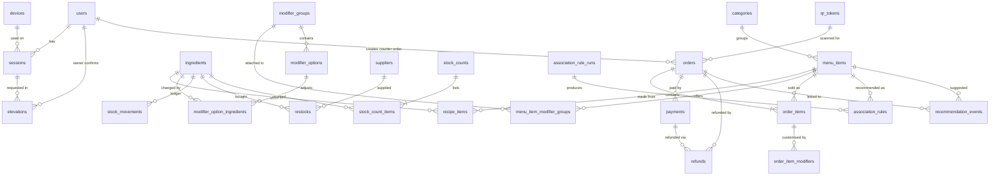

# Binary Brew — Backend Schema

| | |
|---|---|
| Version | 0.1 (draft) |
| Date | 2026-10-08 |
| Database | PostgreSQL 16 (Docker, local-first) |
| Related | [01 PRD](01-product-requirements.md) · [02 Tech](02-technical-requirements.md) · [03 App Flow](03-app-flow.md) |

The SQL in section 3 is the **source of truth for intent**. The implementation uses Drizzle ORM: tables, columns, enums and foreign keys are declared in `src/db/schema.ts`; check constraints, partial unique indexes, views, functions and triggers live in hand-written SQL migrations (`src/db/migrations/*.sql`). A test (`tests/db/schema.test.ts`) must confirm the migrated database contains every constraint named here.

---

## 1. Conventions

| Topic | Convention |
|---|---|
| Names | `snake_case`, plural table names, `_id` suffix for foreign keys. |
| IDs | `uuid` (`gen_random_uuid()`) for business entities; `bigint generated always as identity` for high-volume append-only ledgers (`stock_movements`, `audit_logs`, `payment_events`, `recommendation_events`). |
| Money | Whole rupiah in `integer` columns (max about 2.1 billion per value). Sums in reports are cast to `bigint`. No floats, no decimals for money. Ingredient *cost per unit* is `numeric(14,4)` because it can be fractions of a rupiah per gram. |
| Quantities | `numeric(14,3)` in the ingredient's base unit (`g`, `ml`, `pcs`). |
| Time | `timestamptz` stored in UTC. `business_date` (`date`) is computed in the app as (local time in Asia/Jakarta − cutoff). |
| Rates | Basis points (`bps`): 1100 = 11.00 %. |
| Deletion | Business data is deactivated (`is_active = false`), not deleted. Ledgers are append-only. |
| Snapshots | Orders copy names, prices, tax and cost at the time of sale so later menu changes never rewrite history. |
| Personal data | None is stored about customers (BR-13). Staff have a name and, for the owner, an email. |

## 2. Entity overview



Table groups: **Access** (`users`, `devices`, `sessions`, `elevations`), **Catalog** (`categories`, `menu_items`, `modifier_groups`, `modifier_options`, `menu_item_modifier_groups`, `ingredients`, `recipe_items`, `modifier_option_ingredients`), **Orders and payments** (`qr_tokens`, `queue_counters`, `orders`, `order_items`, `order_item_modifiers`, `payments`, `payment_events`, `refunds`), **Inventory** (`suppliers`, `restocks`, `stock_movements`, `stock_counts`, `stock_count_items`), **Recommendations** (`association_rule_runs`, `association_rules`, `recommendation_events`), **System** (`settings`, `audit_logs`).

## 3. DDL

Run in this order (the Drizzle migrations must produce the same result).

```sql
-- ============================================================
-- 3.1 Enums
-- ============================================================
create type user_role           as enum ('owner', 'staff', 'barista');
create type device_kind         as enum ('counter', 'kitchen', 'other');
create type order_channel       as enum ('self_order', 'counter');
create type order_status        as enum ('awaiting_payment', 'paid', 'preparing', 'ready', 'completed', 'expired', 'voided');
create type payment_method      as enum ('qris_dynamic', 'qris_static_manual', 'cash');
create type payment_status      as enum ('pending', 'paid', 'failed', 'expired', 'refunded');
create type refund_status       as enum ('requested', 'processed');
create type ingredient_kind     as enum ('raw', 'resale');
create type stock_movement_type as enum ('opening', 'restock', 'sale_deduction', 'void_return', 'waste', 'count_adjustment');
create type reco_action         as enum ('shown', 'accepted', 'rejected');

-- ============================================================
-- 3.2 Access
-- ============================================================
create table users (
  id                  uuid primary key default gen_random_uuid(),
  name                text not null,
  role                user_role not null,
  email               text,
  password_hash       text,                      -- argon2id; owner only
  pin_hash            text not null,             -- argon2id; 4-6 digit PIN
  is_active           boolean not null default true,
  failed_pin_attempts integer not null default 0 check (failed_pin_attempts >= 0),
  locked_until        timestamptz,
  created_at          timestamptz not null default now(),
  updated_at          timestamptz not null default now(),
  constraint users_owner_has_login check (role <> 'owner' or (email is not null and password_hash is not null))
);
create unique index users_email_lower_uq on users (lower(email)) where email is not null;

create table devices (
  id            uuid primary key default gen_random_uuid(),
  name          text not null,                   -- e.g. "Counter tablet"
  kind          device_kind not null default 'counter',
  token_hash    text not null unique,            -- hash of the device cookie value
  registered_by uuid references users(id),
  registered_at timestamptz not null default now(),
  last_seen_at  timestamptz,
  revoked_at    timestamptz
);

create table sessions (
  id               uuid primary key default gen_random_uuid(),
  user_id          uuid not null references users(id) on delete cascade,
  device_id        uuid references devices(id),
  token_hash       text not null unique,         -- hash of the opaque session cookie
  created_at       timestamptz not null default now(),
  last_activity_at timestamptz not null default now(),
  expires_at       timestamptz not null,
  revoked_at       timestamptz
);
create index sessions_user_idx on sessions (user_id);

create table elevations (                        -- short-lived owner confirmation for one sensitive action
  id            uuid primary key default gen_random_uuid(),
  session_id    uuid not null references sessions(id) on delete cascade,
  owner_user_id uuid not null references users(id),
  scope         text not null,                   -- e.g. 'void_order', 'manual_payment', 'stock_adjustment'
  expires_at    timestamptz not null,
  used_at       timestamptz,
  created_at    timestamptz not null default now()
);

-- ============================================================
-- 3.3 Catalog
-- ============================================================
create table categories (
  id         uuid primary key default gen_random_uuid(),
  name       text not null unique,
  sort_order integer not null default 0,
  is_active  boolean not null default true
);

create table menu_items (
  id              uuid primary key default gen_random_uuid(),
  category_id     uuid not null references categories(id),
  name            text not null,
  description     text,
  price           integer not null check (price >= 0),
  image_url       text,
  is_active       boolean not null default true,
  is_promoted     boolean not null default false,   -- owner "promote" flag for recommendations
  manual_sold_out boolean not null default false,   -- staff toggle
  sort_order      integer not null default 0,
  created_at      timestamptz not null default now(),
  updated_at      timestamptz not null default now()
);
create index menu_items_category_idx on menu_items (category_id, sort_order);

create table ingredients (
  id            uuid primary key default gen_random_uuid(),
  name          text not null unique,
  kind          ingredient_kind not null default 'raw',      -- 'resale' = bought ready-made (croissant)
  unit          text not null check (unit in ('g', 'ml', 'pcs')),
  stock_qty     numeric(14,3) not null default 0,            -- may go negative (BR-05)
  avg_cost      numeric(14,4) not null default 0 check (avg_cost >= 0),  -- rupiah per unit, weighted average
  min_stock_qty numeric(14,3) not null default 0 check (min_stock_qty >= 0),
  is_active     boolean not null default true,
  created_at    timestamptz not null default now(),
  updated_at    timestamptz not null default now()
);

create table recipe_items (
  menu_item_id  uuid not null references menu_items(id) on delete cascade,
  ingredient_id uuid not null references ingredients(id),
  qty           numeric(12,3) not null check (qty > 0),
  primary key (menu_item_id, ingredient_id)
);

create table modifier_groups (
  id         uuid primary key default gen_random_uuid(),
  name       text not null,                                   -- "Ukuran", "Gula", "Es", "Tambahan"
  min_select smallint not null default 0 check (min_select >= 0),
  max_select smallint not null default 1 check (max_select >= 1),
  sort_order integer not null default 0,
  is_active  boolean not null default true,
  constraint modifier_groups_range check (max_select >= min_select)
);

create table modifier_options (
  id          uuid primary key default gen_random_uuid(),
  group_id    uuid not null references modifier_groups(id) on delete cascade,
  name        text not null,                                  -- "Large", "Less sugar", "Extra shot"
  price_delta integer not null default 0,                     -- rupiah, may be negative
  is_default  boolean not null default false,
  is_active   boolean not null default true,
  sort_order  integer not null default 0
);
create index modifier_options_group_idx on modifier_options (group_id, sort_order);

create table menu_item_modifier_groups (
  menu_item_id uuid not null references menu_items(id) on delete cascade,
  group_id     uuid not null references modifier_groups(id) on delete cascade,
  sort_order   integer not null default 0,
  primary key (menu_item_id, group_id)
);

create table modifier_option_ingredients (        -- extra shot = +9 g beans; sugar/ice options have no rows
  option_id     uuid not null references modifier_options(id) on delete cascade,
  ingredient_id uuid not null references ingredients(id),
  qty_delta     numeric(12,3) not null check (qty_delta <> 0),   -- negative = uses less
  primary key (option_id, ingredient_id)
);

-- ============================================================
-- 3.4 Orders and payments
-- ============================================================
create table qr_tokens (                          -- tokens printed in the QR codes (table, entrance)
  id         uuid primary key default gen_random_uuid(),
  label      text not null,                       -- "Meja 3", "Pintu masuk"
  token      text not null unique,                -- random, URL-safe
  is_active  boolean not null default true,
  created_at timestamptz not null default now(),
  rotated_at timestamptz
);

create table queue_counters (                     -- one row per business day
  business_date date primary key,
  last_number   integer not null default 0
);

create table orders (
  id                 uuid primary key default gen_random_uuid(),
  public_token       text not null unique,        -- random; used in status and receipt URLs
  business_date      date not null,
  queue_number       integer,                     -- assigned when paid (BR-04)
  channel            order_channel not null,
  status             order_status not null default 'awaiting_payment',
  qr_token_id        uuid references qr_tokens(id),
  created_by         uuid references users(id),   -- set for counter orders
  client_session     text,                        -- random per-browser id; not personal data
  subtotal           integer not null check (subtotal >= 0),
  service_charge_bps integer not null default 0 check (service_charge_bps >= 0),
  service_charge     integer not null default 0 check (service_charge >= 0),
  tax_rate_bps       integer not null default 0 check (tax_rate_bps >= 0),
  tax_amount         integer not null default 0 check (tax_amount >= 0),   -- portion already included in total
  tax_inclusive      boolean not null default true,
  total              integer not null check (total >= 0),
  expires_at         timestamptz,                 -- for awaiting_payment
  paid_at            timestamptz,
  preparing_at       timestamptz,
  ready_at           timestamptz,
  completed_at       timestamptz,
  voided_at          timestamptz,
  voided_by          uuid references users(id),
  void_reason        text,
  is_seed            boolean not null default false,   -- demo/imported data
  created_at         timestamptz not null default now(),
  updated_at         timestamptz not null default now(),
  constraint orders_queue_number_iff_paid check ((queue_number is null) = (paid_at is null)),
  constraint orders_paid_states check (status in ('awaiting_payment', 'expired') or paid_at is not null),
  constraint orders_expired_unpaid check (status <> 'expired' or paid_at is null),
  constraint orders_voided_complete check (status <> 'voided' or (paid_at is not null and void_reason is not null and voided_by is not null)),
  constraint orders_total_matches check (total = subtotal + service_charge + case when tax_inclusive then 0 else tax_amount end),
  constraint orders_counter_has_creator check (channel <> 'counter' or created_by is not null),
  constraint orders_self_order_has_qr check (channel <> 'self_order' or qr_token_id is not null)
);
create unique index orders_queue_uq        on orders (business_date, queue_number) where queue_number is not null;
create index orders_status_idx             on orders (status, created_at);
create index orders_business_date_idx      on orders (business_date);
create index orders_client_session_idx     on orders (client_session) where status = 'awaiting_payment';
create index orders_expiry_idx             on orders (expires_at) where status = 'awaiting_payment';

create table order_items (
  id              uuid primary key default gen_random_uuid(),
  order_id        uuid not null references orders(id) on delete cascade,
  menu_item_id    uuid not null references menu_items(id),
  name_snapshot   text not null,
  unit_price      integer not null check (unit_price >= 0),     -- base price at time of sale
  modifiers_total integer not null default 0,                   -- sum of option price deltas per unit
  quantity        smallint not null check (quantity between 1 and 20),
  line_total      integer not null check (line_total >= 0),
  unit_cogs       integer,                                      -- HPP per unit incl. modifiers, set when paid; null if recipe incomplete
  constraint order_items_line_total_matches check (line_total = (unit_price + modifiers_total) * quantity)
);
create index order_items_order_idx on order_items (order_id);
create index order_items_menu_idx  on order_items (menu_item_id);

create table order_item_modifiers (
  id                    uuid primary key default gen_random_uuid(),
  order_item_id         uuid not null references order_items(id) on delete cascade,
  modifier_option_id    uuid references modifier_options(id) on delete set null,
  group_name_snapshot   text not null,
  option_name_snapshot  text not null,
  price_delta_snapshot  integer not null default 0,
  ingredient_deltas     jsonb not null default '[]'::jsonb      -- [{"ingredientId": "...", "qtyDelta": 9}]
);
create index order_item_modifiers_item_idx on order_item_modifiers (order_item_id);

create table payments (
  id               uuid primary key default gen_random_uuid(),
  order_id         uuid not null references orders(id),
  method           payment_method not null,
  status           payment_status not null default 'pending',
  amount           integer not null check (amount > 0),
  provider         text,                                        -- 'mock', 'midtrans', ...
  provider_ref     text,                                        -- gateway transaction id
  qr_string        text,                                        -- QRIS payload to render
  expires_at       timestamptz,
  paid_at          timestamptz,
  confirmed_by     uuid references users(id),                   -- manual confirmations
  elevation_id     uuid references elevations(id),
  manual_reference text,
  manual_note      text,
  created_at       timestamptz not null default now(),
  updated_at       timestamptz not null default now(),
  constraint payments_manual_has_confirmer check (method <> 'qris_static_manual' or (confirmed_by is not null and manual_reference is not null)),
  constraint payments_paid_has_time check (status not in ('paid', 'refunded') or paid_at is not null)
);
create unique index payments_one_live_per_order on payments (order_id) where status in ('pending', 'paid');
create unique index payments_provider_ref_uq    on payments (provider, provider_ref) where provider_ref is not null;
create index payments_order_idx                 on payments (order_id);

create table payment_events (                    -- raw webhook log; gives idempotency
  id           bigint generated always as identity primary key,
  provider     text not null,
  event_id     text not null,
  payload      jsonb not null,
  received_at  timestamptz not null default now(),
  processed_at timestamptz,
  outcome      text,
  unique (provider, event_id)
);

create table refunds (
  id           uuid primary key default gen_random_uuid(),
  order_id     uuid not null references orders(id),
  payment_id   uuid not null references payments(id),
  amount       integer not null check (amount > 0),
  reason       text not null,
  status       refund_status not null default 'requested',
  requested_by uuid not null references users(id),
  approved_by  uuid not null references users(id),             -- must have role owner (enforced in app)
  gateway_ref  text,
  created_at   timestamptz not null default now(),
  processed_at timestamptz,
  constraint refunds_processed_has_time check (status <> 'processed' or processed_at is not null)
);
create index refunds_order_idx on refunds (order_id);

-- ============================================================
-- 3.5 Inventory
-- ============================================================
create table suppliers (
  id         uuid primary key default gen_random_uuid(),
  name       text not null unique,
  note       text,
  is_active  boolean not null default true
);

create table restocks (                          -- one row per ingredient bought
  id            uuid primary key default gen_random_uuid(),
  ingredient_id uuid not null references ingredients(id),
  supplier_id   uuid references suppliers(id),
  quantity      numeric(14,3) not null check (quantity > 0),
  total_cost    integer not null check (total_cost >= 0),     -- rupiah paid for the whole quantity
  unit_cost     numeric(14,4) generated always as (total_cost / quantity) stored,
  purchased_on  date not null default current_date,
  created_by    uuid not null references users(id),
  created_at    timestamptz not null default now()
);
create index restocks_ingredient_idx on restocks (ingredient_id, purchased_on);

create table stock_movements (                   -- append-only ledger; ingredients.stock_qty = sum(qty_delta)
  id            bigint generated always as identity primary key,
  ingredient_id uuid not null references ingredients(id),
  type          stock_movement_type not null,
  qty_delta     numeric(14,3) not null check (qty_delta <> 0),
  ref_type      text,                                         -- 'order', 'restock', 'stock_count'
  ref_id        text,
  note          text,
  created_by    uuid references users(id),                    -- null for system (sale deduction)
  created_at    timestamptz not null default now(),
  constraint stock_movements_sign check (
    (type in ('opening', 'restock', 'void_return') and qty_delta > 0)
    or (type in ('sale_deduction', 'waste') and qty_delta < 0)
    or type = 'count_adjustment'
  )
);
create index stock_movements_ingredient_idx on stock_movements (ingredient_id, created_at);
create index stock_movements_ref_idx        on stock_movements (ref_type, ref_id);

create table stock_counts (
  id         uuid primary key default gen_random_uuid(),
  counted_at timestamptz not null default now(),
  counted_by uuid not null references users(id),
  note       text
);

create table stock_count_items (
  id             uuid primary key default gen_random_uuid(),
  stock_count_id uuid not null references stock_counts(id) on delete cascade,
  ingredient_id  uuid not null references ingredients(id),
  system_qty     numeric(14,3) not null,
  counted_qty    numeric(14,3) not null check (counted_qty >= 0),
  variance_qty   numeric(14,3) generated always as (counted_qty - system_qty) stored,
  reason         text check (reason in ('waste', 'spillage', 'counting_error', 'staff_use', 'other')),
  unique (stock_count_id, ingredient_id),
  constraint stock_count_items_reason_required check (counted_qty = system_qty or reason is not null)
);

-- ============================================================
-- 3.6 Recommendations
-- ============================================================
create table association_rule_runs (
  id                 uuid primary key default gen_random_uuid(),
  started_at         timestamptz not null default now(),
  finished_at        timestamptz,
  status             text not null default 'running'
                     check (status in ('running', 'succeeded', 'failed', 'skipped_insufficient_data')),
  transactions_count integer,
  min_support        numeric(6,5) not null,
  min_confidence     numeric(6,5) not null,
  min_lift           numeric(8,4) not null,
  algorithm          text not null default 'apriori',
  library            text,                                     -- e.g. 'mlxtend 0.23'
  note               text
);

create table association_rules (
  id            uuid primary key default gen_random_uuid(),
  run_id        uuid not null references association_rule_runs(id) on delete cascade,
  antecedent    uuid[] not null,                               -- menu_item ids already in the cart
  consequent_id uuid not null references menu_items(id),       -- item to suggest
  support       numeric(6,5) not null,
  confidence    numeric(6,5) not null,
  lift          numeric(8,4) not null,
  is_active     boolean not null default false,                -- true only for the latest successful run
  constraint association_rules_antecedent_size check (cardinality(antecedent) between 1 and 2),
  constraint association_rules_consequent_new check (not (consequent_id = any (antecedent)))
);
create index association_rules_active_idx on association_rules using gin (antecedent) where is_active;
create index association_rules_run_idx    on association_rules (run_id);

create table recommendation_events (
  id             bigint generated always as identity primary key,
  client_session text not null,
  order_id       uuid references orders(id) on delete set null,
  rule_id        uuid references association_rules(id) on delete set null,
  item_id        uuid not null references menu_items(id),
  source         text not null check (source in ('rule', 'promoted')),
  score          numeric(8,4),
  action         reco_action not null,
  created_at     timestamptz not null default now()
);
create index recommendation_events_item_idx  on recommendation_events (item_id, created_at);
create index recommendation_events_order_idx on recommendation_events (order_id);

-- ============================================================
-- 3.7 System
-- ============================================================
create table settings (
  key        text primary key,
  value      jsonb not null,
  updated_by uuid references users(id),
  updated_at timestamptz not null default now()
);

create table audit_logs (                        -- append-only
  id            bigint generated always as identity primary key,
  actor_user_id uuid references users(id),
  device_id     uuid references devices(id),
  action        text not null,                             -- 'order.void', 'payment.manual_confirm', ...
  entity_type   text,
  entity_id     text,
  reason        text,
  metadata      jsonb not null default '{}'::jsonb,
  created_at    timestamptz not null default now()
);
create index audit_logs_entity_idx  on audit_logs (entity_type, entity_id);
create index audit_logs_created_idx on audit_logs (created_at);

-- ============================================================
-- 3.8 Functions, triggers, views
-- ============================================================
create function forbid_mutation() returns trigger
language plpgsql as $$
begin
  raise exception '% is append-only', tg_table_name;
end;
$$;

create trigger audit_logs_append_only
  before update or delete on audit_logs
  for each row execute function forbid_mutation();

create trigger stock_movements_append_only
  before update or delete on stock_movements
  for each row execute function forbid_mutation();

-- Concurrency-safe daily queue number (call inside the "mark paid" transaction)
create function next_queue_number(p_date date) returns integer
language sql as $$
  insert into queue_counters (business_date, last_number)
  values (p_date, 1)
  on conflict (business_date) do update set last_number = queue_counters.last_number + 1
  returning last_number;
$$;

-- Business day = local time minus cutoff (BR-14)
create function business_date_of(ts timestamptz, cutoff interval default interval '4 hours') returns date
language sql immutable as $$
  select ((ts at time zone 'Asia/Jakarta') - cutoff)::date;
$$;

-- HPP per menu item from recipes and weighted-average ingredient cost.
-- has_recipe is false when the item has no recipe lines (HPP unknown, not zero).
create view v_menu_item_cost as
select
  m.id as menu_item_id,
  count(r.ingredient_id) > 0 as has_recipe,
  coalesce(sum(r.qty * i.avg_cost), 0)::numeric(14,2) as hpp
from menu_items m
left join recipe_items r on r.menu_item_id = m.id
left join ingredients i on i.id = r.ingredient_id
group by m.id;

-- Availability for one serving of the base item (modifier deltas are checked in the app at checkout)
create view v_menu_item_availability as
select
  m.id as menu_item_id,
  (
    m.is_active
    and not m.manual_sold_out
    and not exists (
      select 1
      from recipe_items r
      join ingredients i on i.id = r.ingredient_id
      where r.menu_item_id = m.id and i.stock_qty < r.qty
    )
  ) as is_available
from menu_items m;

create view v_low_stock as
select id as ingredient_id, name, unit, stock_qty, min_stock_qty
from ingredients
where is_active and stock_qty <= min_stock_qty;
```

### 3.9 Default settings

```sql
insert into settings (key, value) values
  ('shop_name',                          '"Binary Brew"'),
  ('timezone',                           '"Asia/Jakarta"'),
  ('business_day_cutoff',                '"04:00"'),
  ('ordering_enabled',                   'true'),
  ('tax_rate_bps',                       '0'),
  ('tax_inclusive',                      'true'),
  ('service_charge_bps',                 '0'),
  ('order_expiry_minutes',               '10'),
  ('ready_auto_complete_minutes',        '30'),
  ('cash_enabled',                       'false'),
  ('manual_payment_requires_owner_pin',  'true'),
  ('reco_min_support',                   '0.02'),
  ('reco_min_confidence',                '0.25'),
  ('reco_min_lift',                      '1.05'),
  ('reco_min_orders',                    '300'),
  ('reco_promote_weight',                '0.5'),
  ('reco_margin_weight',                 '0.25'),
  ('reco_max_items',                     '2'),
  ('low_margin_threshold_pct',           '30'),
  ('order_retention_months',             '24')
on conflict (key) do nothing;
```

## 4. Invariants (must always hold)

Each of these has an automated test (see the implementation plan, Phase 1–3).

| # | Invariant | Enforced by |
|---|---|---|
| I1 | An order has a `queue_number` if and only if it has `paid_at`. | `orders_queue_number_iff_paid` |
| I2 | `(business_date, queue_number)` is unique. | `orders_queue_uq` + `next_queue_number()` |
| I3 | `total = subtotal + service_charge` (+ tax only when tax is not inclusive). | `orders_total_matches` |
| I4 | Each order line's total equals `(unit_price + modifiers_total) × quantity`. | `order_items_line_total_matches` |
| I5 | An order has at most one pending or paid payment at a time. | `payments_one_live_per_order` |
| I6 | The same gateway event is processed at most once. | `payment_events (provider, event_id)` unique |
| I7 | For every ingredient, `stock_qty = Σ stock_movements.qty_delta`. | Written together in one transaction; reconciliation query below |
| I8 | Audit log and stock movements cannot be updated or deleted. | `forbid_mutation` triggers |
| I9 | Only one active set of association rules exists (those of the latest successful run). | Job swaps `is_active` in one transaction |
| I10 | A voided order was paid and has a reason and an actor. | `orders_voided_complete` |

Reconciliation query for I7 (should return zero rows):

```sql
select i.id, i.name, i.stock_qty, coalesce(sum(m.qty_delta), 0) as ledger_qty
from ingredients i
left join stock_movements m on m.ingredient_id = i.id
group by i.id, i.name, i.stock_qty
having i.stock_qty <> coalesce(sum(m.qty_delta), 0);
```

## 5. Transaction recipes

All multi-step changes happen inside one database transaction. Lock rows in a fixed order (orders first, then ingredients sorted by id) to avoid deadlocks.

### 5.1 Create order (self-order or counter)

1. Validate the QR token (self-order) or the staff session (counter).
2. Check the client's open unpaid orders (BR-11).
3. Load menu items, modifier options and settings; **ignore any prices from the client**.
4. Validate modifier min/max per group and availability (`v_menu_item_availability` plus modifier ingredient deltas against `ingredients.stock_qty`). If anything is unavailable, abort with the list of items.
5. Calculate `subtotal`, `service_charge = round(subtotal × service_charge_bps / 10000)`, `total = subtotal + service_charge`, `tax_amount = round(total × tax_rate_bps / (10000 + tax_rate_bps))` (inclusive tax).
6. Insert `orders` (status `awaiting_payment`, `expires_at = now() + expiry`, new `public_token`, `business_date`), `order_items`, `order_item_modifiers` (with snapshots).
7. Call the payment provider to create the charge; insert `payments` (`pending`, `qris_dynamic`). If the provider call fails, roll back.

### 5.2 Mark paid (webhook, or manual confirmation)

1. Webhook: verify signature, insert into `payment_events` (`on conflict do nothing`); if no row was inserted the event is a duplicate, so stop with success.
2. `select … from orders where id = $1 for update`.
3. If the order is `awaiting_payment`: continue. If `expired`: re-check availability; if available, revive (continue), else set the payment `paid`, insert a `refunds` row (`requested`, reason "paid after expiry, item unavailable") and alert the owner (PRD FR-PM-07). If already paid or later: do nothing.
4. Update `payments` to `paid` with `paid_at`.
5. `queue_number = next_queue_number(business_date)`; update order to `paid`, set `paid_at`.
6. (Phase 2) For each order line and modifier, compute ingredient quantities × order quantity; insert `stock_movements` of type `sale_deduction`, update `ingredients.stock_qty`; compute `order_items.unit_cogs` from current `avg_cost`.
7. Write `audit_logs` for manual confirmations. Emit `NOTIFY order_events` after commit.

### 5.3 Status changes

`paid → preparing → ready → completed` each set the matching timestamp. Moving backwards is not allowed. A scheduled sweep sets `ready → completed` after `ready_auto_complete_minutes`, and `awaiting_payment → expired` once `expires_at` has passed (also marking its pending payment `expired`).

### 5.4 Void (Phase 3)

1. Require a valid unused elevation for scope `void_order`; mark it used.
2. Lock the order; allow only from `paid`, `preparing` or `ready`.
3. Set `voided`, `voided_at`, `voided_by`, `void_reason`.
4. If the status was `paid`: insert `void_return` movements that reverse the sale deduction. Otherwise insert `waste` movements. Update `ingredients.stock_qty`.
5. Insert a `refunds` row (`requested`) for the payment amount; write `audit_logs`.
6. Later, the owner marks the refund `processed` after refunding in the gateway dashboard; set `payments.status = 'refunded'`.

### 5.5 Restock and weighted-average cost (Phase 2)

For each purchased ingredient:

```
base_qty = greatest(ingredient.stock_qty, 0)
new_avg  = (base_qty * ingredient.avg_cost + quantity * unit_cost) / (base_qty + quantity)
```

Insert the `restocks` row and a `restock` movement, update `stock_qty` and `avg_cost`. Because `base_qty` is never negative, a negative stock balance does not distort the average (BR-09).

### 5.6 Stock count (Phase 3)

Owner enters counted quantities. For each ingredient with a difference, require a reason, insert a `count_adjustment` movement of `counted_qty − system_qty`, and set `stock_qty` to the counted value. Elevation scope `stock_adjustment`.

### 5.7 Recommendation job (Phase 1)

1. Insert `association_rule_runs` (`running`) with the thresholds from settings.
2. Read baskets: distinct `menu_item_id` per order for orders with `paid_at is not null` and status not `voided`.
3. If fewer than `reco_min_orders` baskets: set `skipped_insufficient_data`, keep old rules active.
4. Run Apriori; insert `association_rules` with `is_active = false`.
5. In one transaction: set all old rules `is_active = false`, set the new run's rules `is_active = true`, mark the run `succeeded`.

## 6. Reference queries

Best sellers and peak hours (owner dashboard):

```sql
select oi.name_snapshot as item, sum(oi.quantity) as qty, sum(oi.line_total)::bigint as revenue
from order_items oi
join orders o on o.id = oi.order_id
where o.paid_at is not null and o.status <> 'voided'
  and o.business_date between $1 and $2
group by oi.name_snapshot
order by qty desc
limit 10;
```

```sql
select extract(hour from o.paid_at at time zone 'Asia/Jakarta')::int as hour_of_day,
       count(*) as orders
from orders o
where o.paid_at is not null and o.status <> 'voided'
  and o.business_date between $1 and $2
group by 1
order by 1;
```

Margin per item (HPP report):

```sql
select m.id, m.name, m.price,
       c.has_recipe,
       c.hpp,
       case when c.has_recipe then m.price - c.hpp end as margin,
       case when c.has_recipe and m.price > 0
            then round(((m.price - c.hpp) / m.price * 100)::numeric, 1) end as margin_pct
from menu_items m
join v_menu_item_cost c on c.menu_item_id = m.id
where m.is_active
order by margin_pct nulls last;
```

Stock variance per count (theoretical vs actual):

```sql
select i.name, ci.system_qty, ci.counted_qty, ci.variance_qty, ci.reason, sc.counted_at
from stock_count_items ci
join stock_counts sc on sc.id = ci.stock_count_id
join ingredients i on i.id = ci.ingredient_id
order by sc.counted_at desc, abs(ci.variance_qty) desc;
```

Recommendation performance:

```sql
select e.item_id,
       count(*) filter (where e.action = 'shown')    as shown,
       count(*) filter (where e.action = 'accepted') as accepted,
       round(100.0 * count(*) filter (where e.action = 'accepted')
             / nullif(count(*) filter (where e.action = 'shown'), 0), 1) as acceptance_pct
from recommendation_events e
where e.created_at >= $1
group by e.item_id
order by accepted desc;
```

Order-to-ready time during the evening rush (success metric):

```sql
select percentile_cont(0.5) within group (order by extract(epoch from (ready_at - paid_at))) as median_seconds,
       percentile_cont(0.9) within group (order by extract(epoch from (ready_at - paid_at))) as p90_seconds
from orders
where ready_at is not null
  and (paid_at at time zone 'Asia/Jakarta')::time between '18:00' and '21:00';
```

## 7. Seed data

`npm run db:seed` loads, in this order (it is idempotent: rows are matched by natural key, created only when missing, and existing rows are never changed):

1. Settings (3.9), one owner user (email, password and PIN from the `SEED_*` variables in `.env`), two staff users, one counter device.
2. Categories, about 12 menu items, modifier groups (Ukuran, Gula, Es, Tambahan) and options.
3. QR tokens: "Pintu masuk" and "Meja 1" to "Meja 6".
4. (Phase 2) Ingredients, recipes, an opening stock movement for each ingredient.
5. About 2,000 synthetic paid orders over 60 days (`is_seed = true`) generated with planted pairings (for example kopi susu + croissant) and realistic evening peaks, so the Apriori job has something to find. The generator is deterministic (fixed random seed) and documented, so the demo can state exactly how the data was made.

## 8. Retention and privacy

- No customer personal data is stored, so there is nothing to anonymise.
- `client_session` is a random id with no link to a person. It is only used to cap open orders and to link recommendation events to an order.
- Order records are kept for `order_retention_months` (24). The Phase 4 retention job asks the owner for confirmation, then deletes older orders; `order_items` and `order_item_modifiers` cascade, while `payments` and `refunds` follow the same rule.
- `audit_logs` and `stock_movements` are never deleted by the app.

## 9. Indexing and growth notes

- Expected volume is tiny (a few hundred orders per day at most), so the indexes above are about correctness and clarity, not scale.
- Partial indexes keep the hot paths (awaiting payment, active rules) small.
- To add a second outlet later, add `outlet_id` to `orders`, `ingredients`, `stock_movements`, `queue_counters` (part of its key) and `settings`; the module boundaries in [02 Technical Requirements](02-technical-requirements.md) keep that change mechanical. It is deliberately not modelled now.
